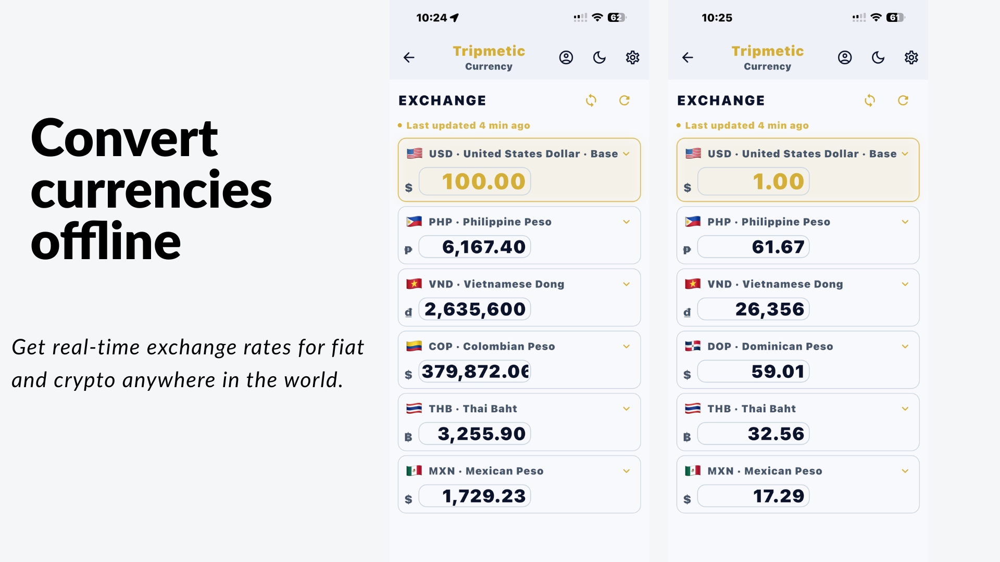
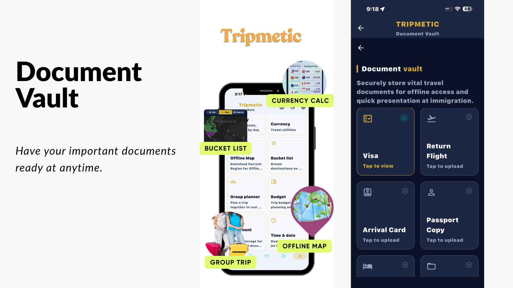
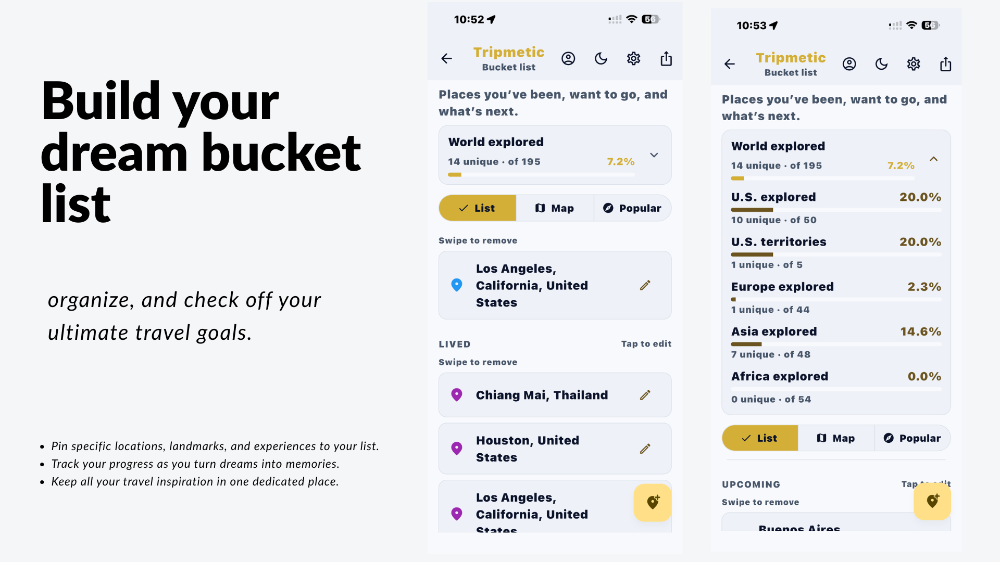
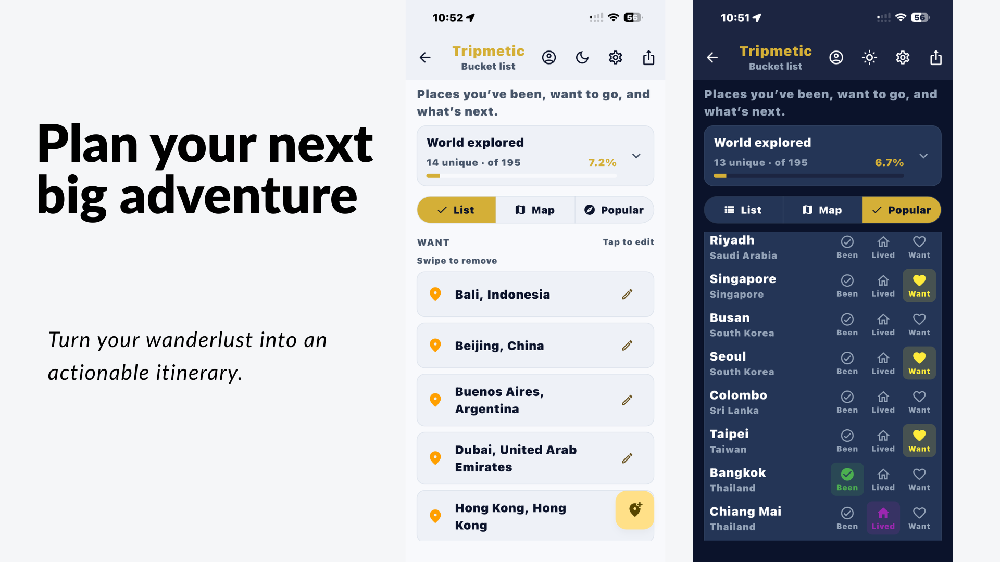
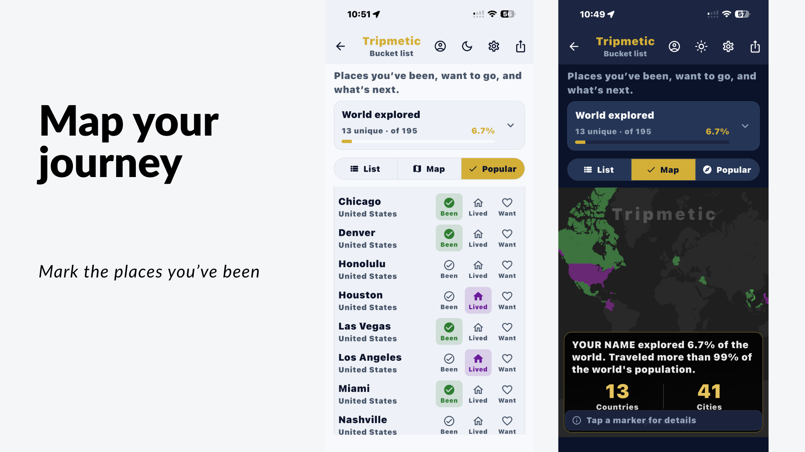
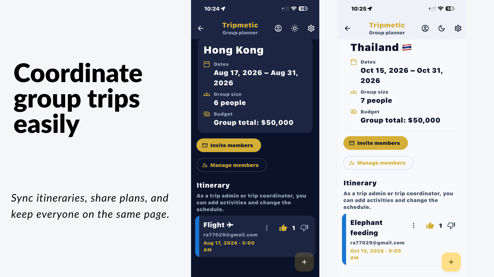
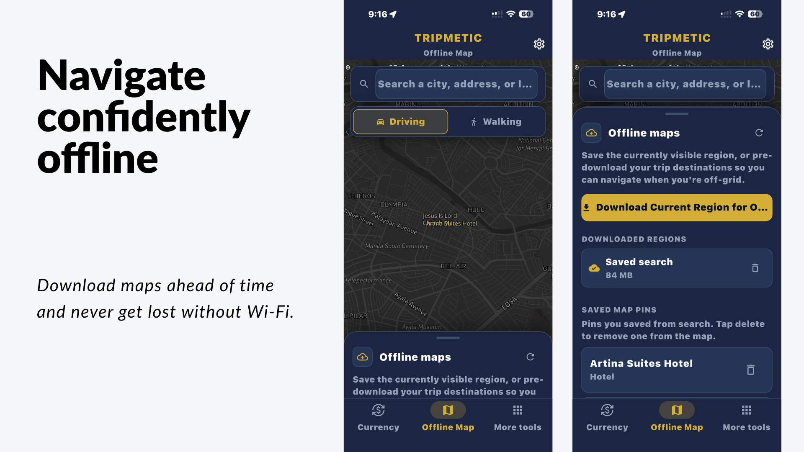

# Tripmetic

<p align="center">
  
</p>

[](https://docs.flutter.dev/)
[](https://dart.dev/)
[](https://nodejs.org/)
[](LICENSE)
[](https://github.com/DTLA-Professional-Services-LLC/Tripmetic/actions/workflows/secret-scan.yml)

**Tripmetic** is a Flutter travel companion with live currency tools, offline maps, multi-country budgets, packing lists, a global time scheduler, document vault, and group planning.

**Tripmetic Pro** is an auto-renewing monthly subscription (with a 3-day free trial where eligible) that unlocks premium tools. A small set of features remains free — see [Free vs Pro](#free-vs-pro).

## Key features

A quick look at what Tripmetic can do — every screen below ships in the open-source app.

<table>
  <tr>
    <td width="50%" align="center" valign="top">
      
      <br /><br />
      <strong>Document Vault</strong><br />
      <sub>Store visas, passports, and travel documents for secure, offline access.</sub>
    </td>
    <td width="50%" align="center" valign="top">
      
      <br /><br />
      <strong>Bucket List &amp; Trip Planner</strong><br />
      <sub>Track where you have been and the destinations still on your list.</sub>
    </td>
  </tr>
  <tr>
    <td width="50%" align="center" valign="top">
      
      <br /><br />
      <strong>Trip Planner</strong><br />
      <sub>Turn wanderlust into an actionable plan with popular destinations.</sub>
    </td>
    <td width="50%" align="center" valign="top">
      
      <br /><br />
      <strong>Bucket List Map</strong><br />
      <sub>Map your journey and see how much of the world you have explored.</sub>
    </td>
  </tr>
  <tr>
    <td width="50%" align="center" valign="top">
      
      <br /><br />
      <strong>Group Trips, Itinerary &amp; Budget</strong><br />
      <sub>Sync itineraries, share plans, and keep group budgets in sync.</sub>
    </td>
    <td width="50%" align="center" valign="top">
      
      <br /><br />
      <strong>Offline Maps</strong><br />
      <sub>Download regions ahead of time and navigate without Wi-Fi.</sub>
    </td>
  </tr>
</table>

## Open source

Tripmetic is an **open-source project maintained and released by [DTLA Professional Services, LLC](https://dtlaprofessionalservices.com/)**. You are welcome to read the source, build it, self-host it, and contribute.

If you fork this project, please retain this attribution. The upstream project and its trademark are not granted by the license — see [License](#license).

### Maintained & Released By

- **Maintained & Released by:** [DTLA Professional Services, LLC](https://dtlaprofessionalservices.com/)
- **Address:** 770 S Grand Ave, Los Angeles, CA 90017
- **Business Contact:** [info&#64;dtlaprofessionalservices.com](mailto:info%40dtlaprofessionalservices.com) | [(213) 444-2224](tel:+12134442224)
- **Affiliated Brands:** [Key Forecasts (keyforecasts.com)](https://keyforecasts.com)

## Features

| Area | Description |
| --- | --- |
| **Dashboard** | Trip hub — pinned tools and quick access from the bottom bar or More menu. |
| **Currency** | In-app converter with live fiat rates (Firestore + Frankfurter fallback). **Pro** in the main app; the **Android home-screen widget** is free. |
| **Itinerary** | Trip events and planning (Hive + Firestore where configured). |
| **Offline map** | Mapbox map, search, routes, offline region downloads, saved locations. |
| **Budget** | Multi-destination trip budget with per-day estimates. |
| **Packing** | Categorized packing lists with hide-completed. |
| **Scheduler** | Global time / availability across time zones. |
| **Vault** | Travel documents for offline access. |
| **Bucket list** | World travel map and destination tracking. |
| **Group planner** | Shared trips with real-time sync. |
| **More tools** | Units, crypto, tip calculator, size converter, mind map, settings. |
| **Home-screen widgets (Android)** | **Currency converter** (live rates, refresh in background) and **Dual Clock** (two cities). |

Navigation uses **go_router** with a bottom shell; many tools open full-screen routes. Pro-gated screens use a soft glass overlay (`ProGlassOverlay`) with an in-app upgrade sheet.

## Free vs Pro

### Free (no subscription)

- Dashboard, Settings, Units converter, Dual Clock (in-app + widget setup)
- **Currency home-screen widget** on Android — change currencies and refresh rates via `/currency-widget/*` deep links (does not require opening the Pro in-app Currency tool)

### Tripmetic Pro

- Currency converter (in-app), itinerary, offline map, budget, packing, scheduler, vault, bucket list, group planner, crypto, tip calculator, size converter, mind map, and related Pro routes

Access is enforced via **RevenueCat** entitlements and `ProGlassOverlay` on individual features. Subscriptions require a **Google Play** or **App Store** install for billing; sideloaded APKs may show purchases as unavailable.

## Languages

The app supports **10 locales** (Settings → Language, or system default):

| Code | Language |
| --- | --- |
| `en` | English |
| `es` | Español |
| `zh` | 简体中文 |
| `de` | Deutsch |
| `fr` | Français |
| `ja` | 日本語 |
| `pt` | Português |
| `ko` | 한국어 |
| `hi` | हिन्दी |
| `ar` | العربية |

Strings live in `lib/l10n/app_*.arb`. Generated code is in `lib/l10n/generated/`. See [Localization](#localization) for adding or updating translations.

## Tech stack

| Area | Packages / notes |
| --- | --- |
| UI & state | Flutter 3, **Riverpod**, Material 3 |
| Routing | **go_router** |
| i18n | **flutter_localizations**, ARB files, `l10n.yaml` |
| Maps | **mapbox_maps_flutter** (public access token injected at build time) |
| Subscriptions | **RevenueCat** (`purchases_flutter`, `purchases_ui_flutter`). Public SDK keys injected at build time — see [Configuration](#configuration). |
| Widgets | **home_widget** (Android currency + dual-clock widgets; background refresh entry point) |
| Local storage | **Hive** / **hive_flutter** |
| Backend | **Firebase** (Auth, Firestore) where enabled |
| Exchange rates | Firestore `fiat_rates/latest` with **Frankfurter** API fallback |
| Location | **geolocator** |
| Web app | **Next.js 16** (React 19, Tailwind CSS) in `webapp/` |
| Cloud Functions | **Node.js 22** + TypeScript (`firebase-functions`) in `functions/` |

## Prerequisites

- **Flutter SDK 3.44.0 (stable)** with **Dart 3.12.0** included.
- **Node.js 22** with npm for the web app and Cloud Functions.
- Git and Python 3 for the repository tooling.
- Xcode and CocoaPods, or Android Studio and the Android SDK, for native builds.

Optional service accounts unlock the full feature set: Mapbox access tokens, RevenueCat products, and a Firebase project. The app still builds without them, with the affected features disabled.

### Quickstart

**Tech stack:** **Flutter** (mobile & desktop) · **Next.js** (web app) · **Node.js 22**.

```bash
# 1. Clone the repository
git clone https://github.com/DTLA-Professional-Services-LLC/Tripmetic.git
cd Tripmetic

# 2. Install Flutter dependencies
flutter pub get

# 3. Create your local environment file (git-ignored — never commit it)
cp .env.example .env
```

Fill in `.env` with **local test values only**, then pass the values to the app with `--dart-define` — see [Configuration](#configuration).

For web app or Cloud Functions work, install the locked Node dependencies:

```bash
npm ci --prefix webapp
npm ci --prefix functions
```

### Configure local environments

The quickstart above covers the minimum. To set up every local environment file, create them and fill them with **local test values only**:

```bash
cp .env.example .env
cp webapp/.env.example webapp/.env
```

Both destination files are git-ignored. The Flutter app does not load the root `.env` automatically; pass values with `--dart-define` as shown in [Configuration](#configuration).

For native Firebase projects, also copy the platform templates:

```bash
cp android/app/google-services.json.example android/app/google-services.json
cp ios/Runner/GoogleService-Info.plist.example ios/Runner/GoogleService-Info.plist
```

Alternatively, `./scripts/setup_local_config.sh` creates all local config files in one step.

### 2. Pass your keys at compile time

The Flutter app reads every credential from `--dart-define`. Put your keys on
the command line:

```bash
flutter run \
  --dart-define=MAPBOX_ACCESS_TOKEN=pk.xxxxx \
  --dart-define=REVENUECAT_APPLE_KEY=appl.xxxxx \
  --dart-define=REVENUECAT_GOOGLE_KEY=goog.xxxxx
```

| Variable | Where it comes from | If it is missing |
| --- | --- | --- |
| `MAPBOX_ACCESS_TOKEN` | Mapbox → Access tokens → **Public** token | Map views render a neutral surface; geocoding and directions stay off. |
| `REVENUECAT_APPLE_KEY` | RevenueCat → API keys → **App Store** (`appl.…`) | Subscriptions unavailable; the app stays usable. |
| `REVENUECAT_GOOGLE_KEY` | RevenueCat → API keys → **Google Play** (`goog.…`) | Same as above. |
| `FIREBASE_API_KEY` | Firebase Console → Project settings → General | Falls back to the native platform config files. |
| `FIREBASE_APP_ID` | Firebase Console → Project settings → General | Falls back to the native platform config files. |
| `FIREBASE_MESSAGING_SENDER_ID` | Firebase Console → Project settings → General | Falls back to the native platform config files. |
| `FIREBASE_PROJECT_ID` | Firebase Console → Project settings → General | Falls back to the native platform config files. |
| `FIREBASE_STORAGE_BUCKET` | Firebase Console → Project settings → General | Falls back to the native platform config files. |
| `FIREBASE_AUTH_DOMAIN` | Firebase Console → Project settings → General | Falls back to the native platform config files. |

Placeholders are compiled in as defaults, so the app **compiles and boots with
no configuration at all** — the affected feature degrades gracefully instead
of crashing. See `lib/core/config/app_secrets.dart` and
`lib/core/config/firebase_config.dart`.

To keep the command line short, use a JSON file (git-ignored):

```bash
flutter run --dart-define-from-file=config/local.json
```

```json
{
  "MAPBOX_ACCESS_TOKEN": "pk.xxxxx",
  "REVENUECAT_APPLE_KEY": "appl.xxxxx",
  "REVENUECAT_GOOGLE_KEY": "goog.xxxxx"
}
```

`.env.example` lists the same variable names for reference and for CI.

## Configuration

### Android signing

Release signing credentials are never in the repository. Supply them as
Gradle properties or environment variables (this is what CI should do):

```bash
export ORG_GRADLE_PROJECT_storeFile=/path/to/upload-keystore.jks
export ORG_GRADLE_PROJECT_storePassword=…
export ORG_GRADLE_PROJECT_keyAlias=upload
export ORG_GRADLE_PROJECT_keyPassword=…
```

or via the git-ignored `android/key.properties` (see
`android/key.properties.example`). With neither, release builds fall back to
the **debug keystore** — fine locally, never valid for store uploads.

### Android Mapbox downloads token

The secret Mapbox token used to fetch the Mapbox Maven artifacts is supplied
out-of-band:

```bash
export MAPBOX_DOWNLOADS_TOKEN=sk.xxxxx
# or: -PMAPBOX_DOWNLOADS_TOKEN=sk.xxxxx
# or: ~/.gradle/gradle.properties
```

### Web app

The web app loads Firebase Web SDK values from `webapp/.env`. A git-ignored `webapp/.env.local` may be used for local overrides.

`NEXT_PUBLIC_*` values are inlined into the client bundle at build time. They
are public identifiers rather than secrets — restrict the Firebase API key by
authorized domain and API in Google Cloud Console.

### Firebase project and administrators

Select the Firebase project explicitly instead of relying on a project alias in
source control:

```bash
export FIREBASE_PROJECT_ID="your-firebase-project-id"
firebase deploy --only hosting --project "$FIREBASE_PROJECT_ID"
```

Create admin accounts and grant the server-enforced `admin: true` Firebase Auth
custom claim:

```bash
export ADMIN_EMAILS="admin@example.com"
export GOOGLE_APPLICATION_CREDENTIALS="/absolute/path/to/your-firebase-adminsdk.json"
node scripts/create_admin_users.js
```

Admin email addresses are intentionally not stored in the repository. See
[`scripts/README.md`](scripts/README.md).

## Contributor guide

### Security requirements

> [!IMPORTANT]
> **Strict security notice — no secrets, credentials, or private keys in commits.**
> Never commit API keys, access tokens, service account JSON, signing keystores,
> private keys, or `.env` files. The **pre-commit hook** and the GitHub
> **Secret scan** workflow are active on every push and pull request; a detected
> credential fails the check and blocks the merge.

- **Never commit API keys, service account JSON files, private keys, or production secrets.**
- Ensure pre-commit secret scans pass before submitting pull requests.
- **PR checks enforce zero vulnerabilities and passing test suites.**

Enable the repository's pre-commit scanner once:

```bash
git config core.hooksPath .githooks
```

Run the same scan manually before pushing:

```bash
python3 scripts/scan_for_secrets.py
```

The scanner reports only a file, line, and rule name — never the matched value. See [SECURITY.md](SECURITY.md) for credential rotation and vulnerability reporting.

### Local validation

Run the relevant checks before opening a pull request:

```bash
flutter analyze
flutter test
npm --prefix webapp run build
npm --prefix functions run build
```

## Run the app

```bash
flutter pub get
flutter gen-l10n   # after editing .arb files

# With your own keys:
flutter run \
  --dart-define=MAPBOX_ACCESS_TOKEN=pk.xxxxx \
  --dart-define=REVENUECAT_APPLE_KEY=appl.xxxxx \
  --dart-define=REVENUECAT_GOOGLE_KEY=goog.xxxxx
```

Without any `--dart-define` the app still runs — maps and subscriptions are
simply disabled.

## Build

**Android (Play Store — App Bundle):**

```bash
flutter clean
flutter pub get
flutter build appbundle --release \
  --dart-define=MAPBOX_ACCESS_TOKEN=pk.xxxxx \
  --dart-define=REVENUECAT_APPLE_KEY=appl.xxxxx \
  --dart-define=REVENUECAT_GOOGLE_KEY=goog.xxxxx
```

Output: `build/app/outputs/bundle/release/app-release.aab`  
Increment the `+` build number in `pubspec.yaml` before each Play upload.

**iOS (App Store):**

```bash
flutter build ipa --release \
  --dart-define=MAPBOX_ACCESS_TOKEN=pk.xxxxx \
  --dart-define=REVENUECAT_APPLE_KEY=appl.xxxxx \
  --dart-define=REVENUECAT_GOOGLE_KEY=goog.xxxxx
```

Or open `ios/Runner.xcworkspace` in Xcode and archive. CI: `codemagic.yaml` at
repo root — it reads the same variables from the CI environment.

**APK (sideload / local test):**

```bash
flutter build apk --release
```

## Project layout

```text
lib/
  app_bootstrap.dart       # Firebase, Hive, RevenueCat, home_widget callback
  tripmetic_app.dart       # MaterialApp, locale override, theme
  core/
    locale/                # supported_app_locales.dart, app_locale_provider.dart
    router/                # go_router, deep links (incl. currency-widget)
    subscription/          # RevenueCat state, Pro guards, paywall actions
    data/sync/             # Fiat rates (Firestore + Frankfurter composite)
  features/                # Feature modules (currency, map, trip, paywall, …)
  l10n/
    app_en.arb             # Template strings (edit here first)
    app_*.arb              # Per-locale translations
    generated/             # flutter gen-l10n output (do not edit by hand)
  services/
    widget_service.dart    # Android currency widget prefs + sync
    currency_widget_background_callback.dart
android/.../CurrencyWidgetProvider.kt   # Currency home-screen widget
tools/
  generate_arb_translations.py          # Machine-translate from English
  apply_arb_polish.py                   # Apply human-reviewed overrides
  arb_polish_overrides.json
```

## Localization

1. Add or change strings in **`lib/l10n/app_en.arb`** (template). Keep `{placeholders}` and brand names (`Tripmetic`, `RevenueCat`, `Android`, etc.) as documented in `@@context`.
2. Regenerate other locales (optional, uses Google Translate + cache):

   ```bash
   python3 -m venv .venv-l10n && .venv-l10n/bin/pip install deep-translator
   .venv-l10n/bin/python tools/generate_arb_translations.py
   ```

3. Apply curated fixes: edit `tools/arb_polish_overrides.json`, then:

   ```bash
   python3 tools/apply_arb_polish.py
   ```

4. Regenerate Dart bindings:

   ```bash
   flutter gen-l10n
   ```

Language names in Settings use native script labels from `lib/core/locale/supported_app_locales.dart`.

## Development notes

- After native permission or widget manifest changes, fully restart the app on the device.
- **RevenueCat:** Dashboard → Customers; bootstrap logs the offering ID when configuration succeeds.
- **Currency widget:** Keys in `WidgetService` must match `CurrencyWidgetProvider.kt`.
- **Debug Pro locally:** Non-release builds can enable “Test as Tripmetic Pro” in Settings.

## License

Tripmetic is released under the **MIT License**. See [LICENSE](LICENSE).

Third-party dependencies remain under their own licenses (Flutter and the Dart SDK — BSD-3-Clause; Mapbox SDK — Mapbox Terms of Service; Firebase, RevenueCat, and other pub.dev packages — their respective licenses).
